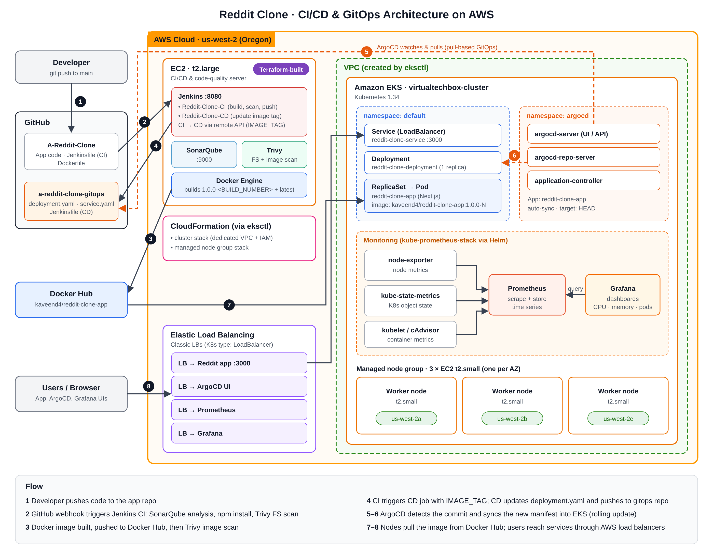

# Reddit Clone: CI/CD & GitOps Pipeline on AWS EKS

An end-to-end DevOps pipeline that takes a Next.js Reddit clone from a GitHub commit to a running deployment on **AWS EKS**. It uses **Jenkins** for CI/CD, **SonarQube** and **Trivy** for code and security scanning, **Docker Hub** as the image registry, **ArgoCD** for GitOps-based delivery, and **Prometheus + Grafana** for monitoring.

> Built as a hands-on learning project, following a tutorial and then working through how each tool connects to the next.

| Repo | Purpose |
|---|---|
| [A-Reddit-Clone](https://github.com/KaveenAlahapperuma/A-Reddit-Clone) | Application source code + CI pipeline (`Jenkinsfile`, `Dockerfile`) |
| [a-reddit-clone-gitops](https://github.com/KaveenAlahapperuma/a-reddit-clone-gitops) | Kubernetes manifests + CD pipeline, watched by ArgoCD |

---

## Architecture



**Pipeline flow (simplified):**

```
 Developer
    │  git push
    ▼
 GitHub (A-Reddit-Clone) ──webhook──► Jenkins: Reddit-Clone-CI
                                         │
                                         ├─ SonarQube code analysis + Quality Gate check
                                         ├─ npm install
                                         ├─ Trivy filesystem scan (dependencies)
                                         ├─ Docker build → push to Docker Hub (1.0.0-<build>, latest)
                                         ├─ Trivy image scan (HIGH / CRITICAL)
                                         └─ Trigger CD job with the new IMAGE_TAG
                                                │
                                                ▼
                                   Jenkins: Reddit-Clone-CD
                                         │  update image tag in deployment.yaml
                                         ▼
                              GitHub (a-reddit-clone-gitops)
                                         │  ArgoCD watches this repo
                                         ▼
                                   ArgoCD auto-sync
                                         │
                                         ▼
                 AWS EKS cluster (Deployment + LoadBalancer Service)
                                         │  metrics scraped
                                         ▼
                         Prometheus ──► Grafana dashboards
```

---

## Tech Stack

| Area | Tools |
|---|---|
| Application | Next.js, TypeScript, Firebase, Node.js |
| CI/CD | Jenkins (two pipelines: CI and CD) |
| Code quality | SonarQube Community + SonarQube Scanner |
| Security scanning | Trivy (filesystem and image scans) |
| Containers | Docker, Docker Hub |
| Orchestration | Kubernetes 1.34 on AWS EKS (provisioned with `eksctl`) |
| GitOps | ArgoCD |
| Monitoring | Prometheus, Grafana (kube-prometheus-stack via Helm) |
| Cloud | AWS (EC2, EKS, IAM, CloudFormation, Elastic Load Balancing), region `us-west-2` |

---

## Infrastructure

| Component | Details |
|---|---|
| Jenkins + SonarQube server | 1 × EC2 `t2.large` (Jenkins on port 8080, SonarQube on port 9000) |
| EKS cluster | `virtualtechbox-cluster`, Kubernetes 1.34, created with `eksctl` |
| Worker nodes | 3 × EC2 `t2.small` in a managed node group, spread across 3 Availability Zones |
| CloudFormation | 2 stacks generated by `eksctl`: one for the cluster (dedicated VPC + IAM), one for the node group |
| Load balancers | 4 AWS LoadBalancers exposing the app, ArgoCD, Prometheus and Grafana |

---

## How the Pipeline Works

### 1. CI pipeline: `Reddit-Clone-CI` ([Jenkinsfile](./Jenkinsfile))

Triggered by a GitHub webhook on every push to `main`. A full run takes about 3 minutes.

| Stage | What it does |
|---|---|
| Clean workspace | Starts each build from a clean directory |
| Checkout | Pulls the latest code from `main` |
| SonarQube Analysis | Scans the source for bugs, code smells and security hotspots |
| Quality Gate | Waits for SonarQube's Quality Gate result |
| Install Dependencies | `npm install` |
| Trivy FS Scan | Scans the project and its dependencies; report saved to `trivyfs.txt` |
| Build & Push Image | Builds the Docker image and pushes `kaveend4/reddit-clone-app:1.0.0-<BUILD_NUMBER>` and `:latest` to Docker Hub |
| Trivy Image Scan | Scans the built image for HIGH and CRITICAL vulnerabilities; report saved to `trivyimage.txt` |
| Cleanup | Removes local images from the Jenkins server to save disk space |
| Trigger CD | Calls the CD job through the Jenkins remote API, passing the new `IMAGE_TAG` |

### 2. CD pipeline: `Reddit-Clone-CD` ([gitops repo](https://github.com/KaveenAlahapperuma/a-reddit-clone-gitops))

1. Checks out the GitOps repo.
2. Uses `sed` to replace the image tag in `deployment.yaml` with the new `IMAGE_TAG`.
3. Commits (`Updated Deployment Manifest`) and pushes the change back to GitHub.

### 3. GitOps delivery: ArgoCD

ArgoCD watches the GitOps repo with **auto-sync enabled**. When `deployment.yaml` changes, it syncs the cluster to match: Kubernetes creates a new ReplicaSet, rolls out a pod with the new image, and the app is exposed through a `LoadBalancer` Service on port 3000. Previous ReplicaSets are kept, so each revision is visible in ArgoCD's history and can be rolled back.

---

## Monitoring & Observability

Monitoring was set up with the **kube-prometheus-stack** Helm chart, which installs Prometheus, Grafana, node-exporter and kube-state-metrics into the cluster.

**How it fits together**

```
 EKS nodes & pods
   │  node-exporter (node metrics: CPU, memory, disk, network)
   │  kube-state-metrics (Kubernetes object state: deployments, pods, replicas)
   │  kubelet / cAdvisor (container metrics)
   ▼
 Prometheus  ── scrapes and stores the metrics as time series
   │
   ▼
 Grafana     ── uses Prometheus as its data source and visualises it in dashboards
```

**Setup steps**

1. Added the `prometheus-community` Helm repo and installed the stack with Helm.
2. Changed the Prometheus and Grafana Services to type `LoadBalancer` so both UIs were reachable from the browser.
3. Logged in to Grafana and confirmed Prometheus was connected as the default data source.
4. Used the built-in Kubernetes dashboards and imported community dashboards for cluster and node metrics.

**What was monitored**

- CPU and memory usage per **namespace**, **workload** and **pod**
- CPU quota vs actual usage, and the number of running pods per workload
- Node-level health of the three EKS worker nodes
- The ArgoCD components themselves (application controller, repo server, Redis, Dex, server), as shown in the Grafana screenshot below

This gave a live view of how the cluster behaved during deployments, for example spotting the extra pod during a rolling update.

---

## Troubleshooting & Challenges

### 1. Jenkins: passing `IMAGE_TAG` from CI to CD

**Problem:** The CD pipeline failed with:

```
groovy.lang.MissingPropertyException: No such property: IMAGE_TAG
```

**Cause:** The CI job sends the new image tag to the separate CD job, but the CD job wasn't receiving or reading the parameter correctly.

**Fix:** Configured `Reddit-Clone-CD` as a parameterised job with an `IMAGE_TAG` string parameter, and had the CI job pass it through the Jenkins remote API (`buildWithParameters?...` with `IMAGE_TAG=${IMAGE_TAG}`). The CD job then uses the same tag the CI job pushed to Docker Hub.

**Learned:** How Jenkins jobs pass build parameters to each other, and why the same image version must flow through the whole pipeline.

### 2. Kubernetes: immutable selector error after a tag update

**Problem:** After the CD job updated `deployment.yaml`, the deployment failed with an immutable-field error.

**Cause:** The `sed` command used to swap the image tag was too broad. It also changed the Deployment's selector and labels, and Kubernetes does not allow `spec.selector` to change on an existing Deployment.

**Fix:** Narrowed the `sed` pattern so it only matches the container image line:

```bash
sed -i 's|image: kaveend4/${APP_NAME}:.*|image: kaveend4/${APP_NAME}:${IMAGE_TAG}|' deployment.yaml
```

**Learned:** Deployment selectors must stay stable, and automated manifest edits should target only the field that needs to change.

### 3. ArgoCD: `504 Gateway Timeout` through Ingress

**Problem:** ArgoCD was first exposed through a Kubernetes Ingress (`argocd-server-ingress`). The Ingress received an AWS load balancer address, but opening ArgoCD returned `504 Gateway Timeout`.

**Investigation:** Followed the traffic path step by step (AWS load balancer → Ingress → `argocd-server` Service → ArgoCD pod) with `kubectl describe ingress`, checking the Service and backend configuration.

**Outcome:** The final working setup exposed `argocd-server` through a `LoadBalancer` Service instead, which is how ArgoCD was accessed in the screenshots above.

**Learned:** How requests travel from an AWS load balancer through Kubernetes networking to a pod, and how to debug each hop.

---

## Why Two Repositories?

- **Separation of concerns:** application code and deployment configuration change for different reasons and at different rates.
- **Git as the source of truth:** the GitOps repo always shows exactly which image version should be running.
- **Easy rollback:** reverting a commit in the GitOps repo rolls the cluster back to the previous version.
- **No build loops:** the CD job commits to a different repo, so it never re-triggers the CI webhook.

---

## Key Features

- Fully automated flow from `git push` to a running pod on EKS
- Code quality and security scanning built into every build
- Every image versioned with the Jenkins build number (11 tags pushed to Docker Hub), so each deployment is traceable
- Pull-based deployment: ArgoCD pulls changes in, Jenkins never needs cluster credentials
- Live cluster monitoring with Prometheus and Grafana
- Infrastructure torn down after testing to keep AWS costs under control

---

## Screenshots

### Jenkins: CI and CD pipelines
Both pipelines passing: `Reddit-Clone-CI` (build #20) and `Reddit-Clone-CD` (build #4).


### SonarQube: code analysis
Quality Gate passed on ~4.5k lines of TypeScript/CSS.


### Docker Hub: versioned images
Each CI build pushes a `1.0.0-<build>` tag plus `latest`.


### ArgoCD: application synced and healthy
Auto-sync enabled, tracking `HEAD` of the GitOps repo.


### ArgoCD: resource tree
Service, Deployment, three ReplicaSet revisions and the running pod.


### Grafana: Kubernetes compute resources
CPU usage and quota per workload, with Prometheus as the data source.


### AWS: EKS cluster


### AWS: CloudFormation stacks created by eksctl


### AWS: EC2 instances (Jenkins/SonarQube server + 3 worker nodes)


### AWS: Load balancers (app, ArgoCD, Prometheus, Grafana)


---

## What I Learned

- How CI and CD can be split into separate Jenkins jobs and connected through the Jenkins remote API with parameters
- How GitOps works in practice: Git holds the desired state and ArgoCD makes the cluster match it
- How Kubernetes rolling updates create new ReplicaSets, and how ArgoCD tracks revisions
- Setting up SonarQube and Trivy inside a pipeline and reading their reports
- Creating and managing an EKS cluster with `eksctl`, and how it uses CloudFormation under the hood
- Managing Jenkins credentials for Docker Hub, GitHub and SonarQube
- Installing Prometheus and Grafana with Helm and reading cluster metrics in dashboards
- Keeping an eye on AWS billing and cleaning up resources after use

---

## Future Improvements

- **Enforce security gates:** Configure the SonarQube Quality Gate and Trivy scans to fail the pipeline when defined security thresholds are exceeded.
- **Remediate security findings:** Investigate and fix the relevant issues reported by SonarQube and Trivy.
- **Improve containerization:** Use a multi-stage Dockerfile with a production build (`next build` and `next start`) and a supported Node.js LTS image.
- **Secure pipeline integration:** Use HTTPS where appropriate and secure the Jenkins CI-to-CD trigger without hardcoded server addresses or exposed credentials.
- **Improve Kubernetes reliability:** Configure readiness and liveness probes, resource requests, and memory limits.
- **Add proactive alerting:** Configure Grafana alerting rules for high CPU usage, pod restarts, and other important cluster-health indicators.
- **Automate infrastructure provisioning:** Use Terraform to provision and manage the AWS infrastructure as code.
- **Improve traffic management:** Replace separate `LoadBalancer` Services with an appropriately configured Ingress controller to reduce unnecessary load balancers and centralize routing.

---

## Author

**Kaveen Alahapperuma**
GitHub: [@KaveenAlahapperuma](https://github.com/KaveenAlahapperuma)
